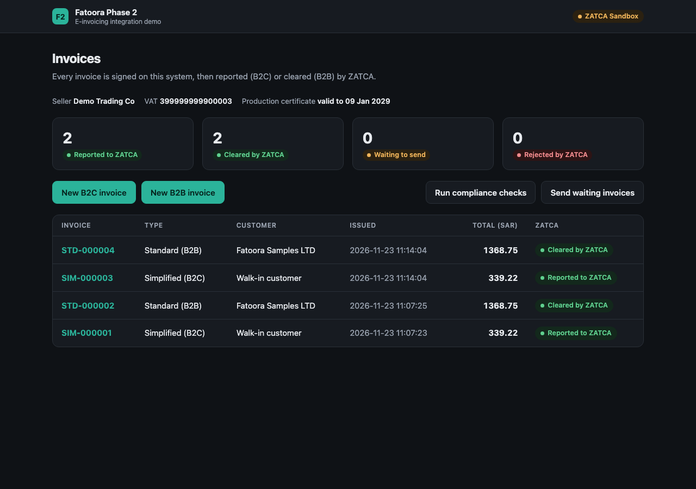
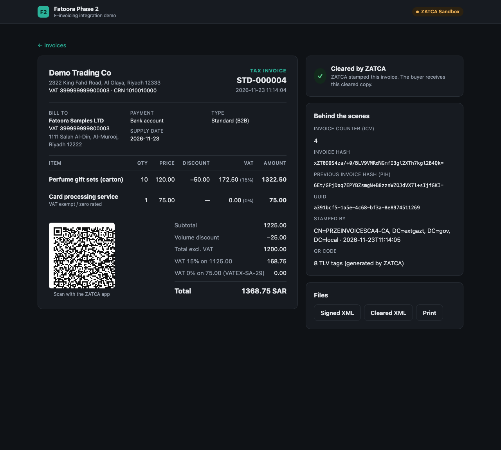

# ZATCA Phase 2 (Fatoora) e-invoicing in Python

A working Phase 2 integration against ZATCA's developer sandbox. It covers device onboarding, the compliance checks, the production CSID, signed UBL 2.1 invoices, QR codes, and reporting and clearance with retries.



## What it covers

| Area | Details |
|---|---|
| **Onboarding** | secp256k1 key and CSR with every ZATCA field (EGS serial, VAT number, invoice types, address, industry, template OID). Compliance CSID, then production CSID. |
| **Documents** | Standard (B2B) and simplified (B2C) invoices, credit notes and debit notes (codes 388 / 381 / 383 with billing reference and reason). |
| **Invoice content** | Seller CRN and full Saudi address, buyer details, supply date, payment means, line and document-level discounts, mixed VAT categories (S / Z / E / O with VATEX reason codes), and both KSA tax-total blocks. |
| **Signing** | Invoice hash (C14N 1.1 with the three XPath exclusions), ECDSA-SHA256 signature, XAdES signed properties, certificate hash, issuer and serial. |
| **QR** | Phase 2 TLV: 9 tags for simplified documents, 8 for standard ones (ZATCA replaces the QR at clearance). |
| **Invoice chain** | Per-device invoice counter (ICV) and previous-invoice hash (PIH), with file locking so concurrent invoices can't break the chain. |
| **Reporting / clearance** | SQLite outbox. B2C documents are reported within 24h, with retries after 1, 5, 15, 60 and 180 minutes and an alert before the deadline. B2B documents are cleared before delivery and ZATCA's stamped copy is stored. An HTTP 303 response (clearance switched off) falls back to reporting. Rejections are recorded and never resent. A claimed row can't be double-submitted. |
| **Validation** | All 6 onboarding documents pass ZATCA's compliance API with no errors or warnings. |



## Verified against ZATCA's own SDK

The developer sandbox does **not** check every part of the signature. In testing it accepted an invoice signed with the wrong key and one with a corrupted signed-properties digest. Those parts were therefore checked against the official ZATCA Java SDK. The SDK signed one of our invoices, and every value it produced had to be reproduced exactly: invoice hash, signature scheme, certificate hash, issuer, serial, and signed-properties digest.

That comparison caught one real difference. The SDK hashes `xades:SignedProperties` as exclusive C14N **with empty elements self-closed** (`<ds:DigestMethod .../>`), not as standard C14N. Without that, an implementation passes the sandbox but fails real signature validation. The SDK output is kept as a test fixture (`tests/test_sdk_parity.py`) so any drift breaks the build.

## Run it

Requires Python 3.11+.

```bash
python3 -m venv .venv
.venv/bin/pip install -r requirements.txt

.venv/bin/python web.py                # dashboard at http://127.0.0.1:8000
```

The dashboard's **Connect to ZATCA sandbox** button runs the full onboarding. You can then issue B2C and B2B invoices and inspect each one: rendered invoice, scannable QR, ZATCA's status, the hash chain, and downloadable signed or cleared XML.

The same steps are available from the command line:

```bash
.venv/bin/python onboard.py            # key + CSR -> compliance CSID
.venv/bin/python compliance_check.py   # the 6 onboarding documents through ZATCA's validator
.venv/bin/python go_live.py            # compliance checks -> production CSID
.venv/bin/python issue.py b2c          # issue + report a simplified invoice
.venv/bin/python issue.py b2b          # issue + clear a standard invoice
.venv/bin/python issue.py retry        # resubmit anything waiting (run from cron)
.venv/bin/python issue.py status       # list invoices, flag B2C ones near the 24h limit

.venv/bin/python -m pytest -q          # 41 tests
```

Keys, certificates and the outbox database are written to `secrets/`, which git ignores.

## Layout

```
zatca/
  config.py       environments (sandbox / simulation / production), EGS unit
  csr.py          key + CSR generation
  models.py       invoice model and totals math (EN 16931 + KSA rules)
  xml_builder.py  UBL 2.1 XML in schema order
  signing.py      hash, signature, XAdES, QR embedding
  qr.py           TLV encode/decode
  chain.py        ICV / PIH chain with locking
  api.py          Fatoora API client (onboarding, compliance, reporting, clearance)
  outbox.py       durable submission queue with retries
  keystore.py     loads the device key and certificates
  reader.py       reads signed or cleared XML back for display
web.py            local dashboard
tests/            unit, outbox (fake ZATCA) and SDK-parity tests
```

## Sandbox notes

- ZATCA's developer portal uses a fixed OTP and issues the **same sample production certificate to everyone**. That certificate can't match this device's key, so in the sandbox only, invoices are signed with the compliance certificate. Reporting then returns a single warning about the certificate. In simulation and production the issued certificate matches the device key, and the code refuses to sign with a certificate that doesn't.
- Moving to simulation or production needs the taxpayer's real VAT details and an OTP from their Fatoora portal: `python onboard.py --env simulation --otp <OTP>`.
- Not covered yet: prepayment invoices (BR-KSA-73/80), non-SAR currencies, and the special transaction flags (third party, nominal, export, summary, self-billed).
